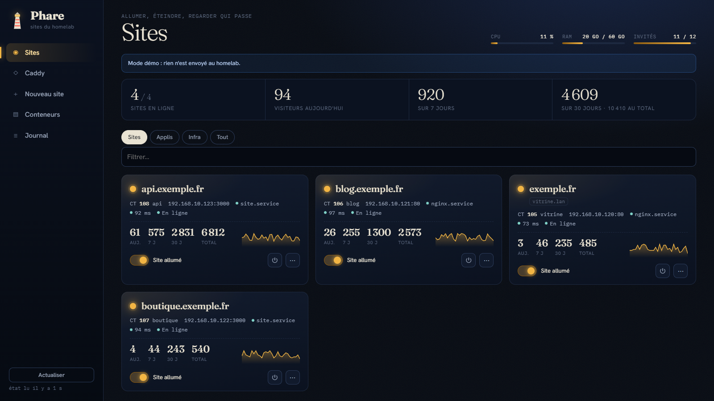
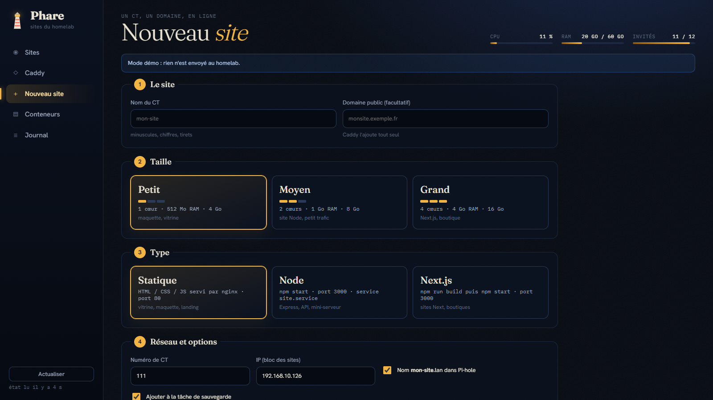

# Phare

Phare est une petite interface web pour gérer les sites de mon homelab Proxmox sans passer par
la ligne de commande. Chaque site tourne dans son propre conteneur LXC, et un Caddy fait le
reverse proxy devant.

Avec Phare je peux :

- voir tous les sites, s'ils répondent, et combien de visiteurs ils ont eu ;
- éteindre un site (le service s'arrête et Caddy affiche une page de maintenance), puis le rallumer ;
- ajouter, rediriger ou retirer un domaine dans Caddy, avec l'historique des versions du Caddyfile ;
- créer un CT de site en quelques clics : taille, type (statique, Node ou Next.js), IP suivante
  du bloc des sites, nom local dans Pi-hole, ajout à la sauvegarde ;
- déployer un site en envoyant un .zip, avec un snapshot pris juste avant ;
- allumer, éteindre, redémarrer un CT, ou le remettre dans l'état d'un snapshot.





## Essayer sans rien installer

Le mode démo fait tourner l'interface avec un faux homelab en mémoire. Rien n'est envoyé nulle
part. Il faut seulement Python 3 (testé avec la 3.12).

```
git clone https://github.com/tom-lion38/phare.git
cd phare
python -m phare --demo --port 8080
```

Puis ouvrir http://localhost:8080.

## Comment ça marche

```
navigateur (réseau local ou VPN)
   |  HTTP, port 80
   v
CT de Phare : Python, bibliothèque standard seulement
   |  SSH avec une clé dédiée
   v
hôte Proxmox : phare-agent (commande forcée)
   |  pct, pvesh
   v
CT des sites, CT de Caddy, Pi-hole, tâche de sauvegarde
```

- Phare tourne dans un CT non privilégié. Le serveur est en Python sans dépendance, l'interface
  en HTML, CSS et JavaScript sans framework.
- Phare n'a pas d'accès root sur l'hôte. Il a une clé SSH dont la ligne dans `authorized_keys`
  force la commande `phare-agent`, n'accepte que l'IP du CT de Phare et coupe le reste
  (`restrict` : pas de shell, pas de redirection de port).
- L'agent ne connaît qu'une liste fermée de verbes : `etat`, `services`, `ct`, `service`,
  `snapshot`, `restaurer-snapshot`, `caddy-lire`, `caddy-ecrire`, `pihole`, `sauvegarde`,
  `creer`, `deployer`, `job` et quelques lectures. Chaque argument est vérifié, rien ne passe
  par un shell, et aucun verbe ne supprime un CT ou des données.
- Les CT de l'infrastructure (Caddy, Pi-hole, Phare lui-même et ceux de `CT_PROTEGES`) ne sont
  jamais pilotés depuis Phare.
- Pour l'état en direct, Phare lit l'API Proxmox avec un jeton en lecture seule (rôle
  PVEAuditor). Sans jeton, il repasse par l'agent.
- Le Caddyfile n'est jamais réécrit en entier. Phare ajoute ou retire une ligne
  `import maintenance`, change l'adresse d'un `reverse_proxy`, ajoute un bloc après un marqueur
  ou retire un bloc. Avant chaque écriture, l'agent fait valider la nouvelle version par Caddy,
  garde l'ancienne (40 versions), recharge, et remet l'ancienne si le rechargement échoue.
- Au déploiement, l'archive est inspectée avant extraction (pas de liens symboliques, pas de
  chemin absolu ni de `..`), extraite par `nobody`, et un snapshot est pris avant. Phare garde
  ses 3 derniers snapshots par CT.
- À chaque création, `modele-ct` applique un modèle commun dans le nouveau CT : pare-feu nftables
  (entrée seulement depuis Caddy, sortie jamais vers le réseau local), mises à jour automatiques,
  SSH par clé, Node 24 par NodeSource avec contrôle de l'empreinte de la clé du dépôt, et service
  systemd bridé.

## Limites, à lire avant d'installer

- **Phare n'a pas de mot de passe.** Toute personne qui atteint son port 80 peut éteindre ou
  créer un site. Il doit rester sur le réseau local ou derrière un VPN, et ne jamais être publié
  sur Internet derrière Caddy. Ce qui le protège : le pare-feu du CT n'ouvre le port 80 qu'aux
  réseaux que tu indiques, l'en-tête `Host` est vérifié (contre le DNS rebinding), et chaque
  requête qui modifie quelque chose doit porter l'en-tête `X-Phare: 1`, qu'un autre site ne peut
  pas envoyer sans une requête CORS préalable que Phare n'accepte jamais.
- Fait pour un seul nœud Proxmox, des CT Debian 13 et un Caddy installé dans un CT avec le paquet
  officiel. Pas essayé en cluster.
- Le DNS public n'est pas géré : Phare affiche l'enregistrement A à créer et vérifie qu'il pointe
  vers ta box.
- Les statistiques de visiteurs viennent de résumés GoAccess au format JSON (un fichier par
  domaine) gardés dans un CT à part. Sans ça, les compteurs restent à zéro.
- Les polices viennent de Google Fonts. Sans accès à Internet, le navigateur prend celles du
  système.

## Installation

Tout est expliqué pas à pas dans [docs/INSTALLATION.md](docs/INSTALLATION.md).

## Tests

```
python -m unittest
```

## Licence

MIT, voir [LICENSE](LICENSE).
